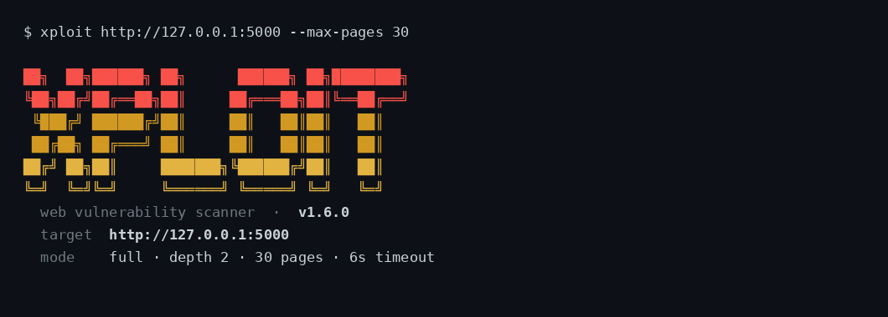
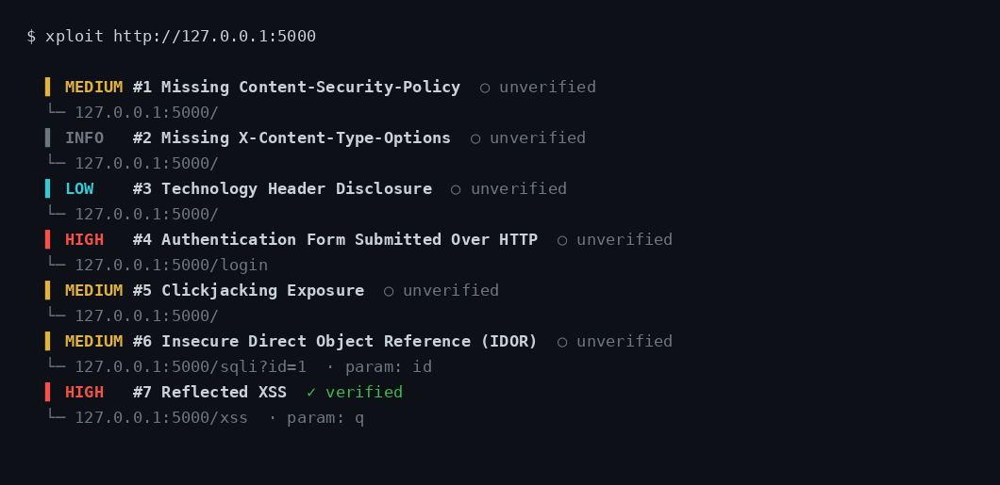
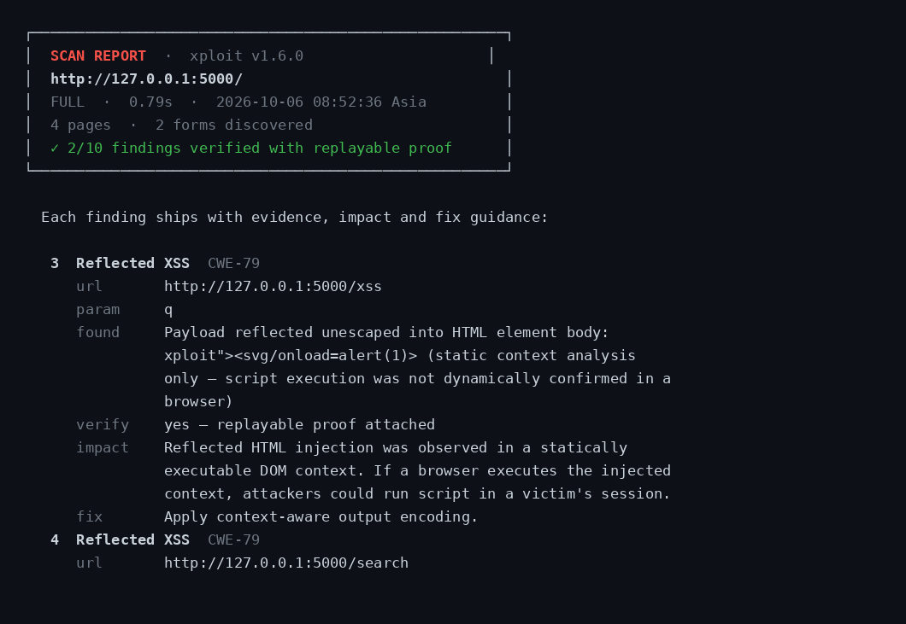
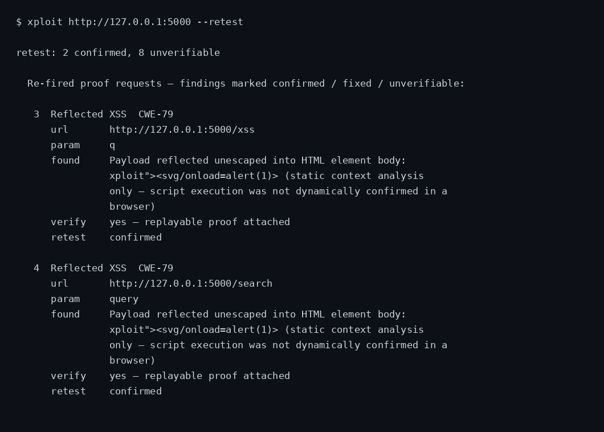

# Xploit

<p align="center">
  
  
  
  
</p>

**Xploit** is a CLI-based web vulnerability scanner designed for authorized security assessments. It performs intelligent crawling, tests for OWASP Top 10 vulnerabilities, and generates professional security reports with CWE classifications.

> ⚠️ **Legal Notice:** Use Xploit only on applications you own or are explicitly authorized to test. Unauthorized scanning is illegal.

---

## 🚀 Features

- **Comprehensive Vulnerability Detection (25+ Types)**
  - **Injection Attacks:** SQL, XSS, Command, LDAP, XML/XXE, NoSQL, SSTI
  - **Authentication Issues:** Username enumeration, weak policies, session management
  - **Sensitive Data Exposure:** Credit cards, SSNs, API keys, private keys, cloud credentials
  - **Security Misconfigurations:** Missing headers, risky methods, directory listing
  - **CSRF, IDOR, Open Redirect, Clickjacking, CORS**

- **Intelligent Crawling**
  - Same-origin enforcement with configurable depth
  - Sitemap and robots.txt discovery, including nested sitemap indexes
    (a `<sitemapindex>` entry's child sitemaps are followed up to 3
    levels deep, same-origin only, with loop protection)
  - OpenAPI/Swagger seeding: a served `/openapi.json`, `/swagger.json`,
    `/openapi.yaml` or `/swagger.yaml` adds its declared paths (templates
    filled, query params seeded) as crawl entry points, so API-only routes
    no linked page mentions still get probed (YAML specs are parsed by a
    stdlib-only subset parser — no PyYAML needed; anchors, aliases, tags
    and multi-document files are not supported and simply yield no seeds).
    Operations with a declared `application/json` requestBody are also
    collected as JSON-body targets: the SQLi and XSS modules probe each
    declared body field with the same payload chains they run against
    query params and form fields, sending the payload as a JSON object
    (`$ref` and `allOf` schemas resolve; POST/PUT/PATCH only)
  - Form extraction and parameter analysis
  - Up to 500 pages per scan
  - Policy-compliant crawling: `--respect-robots` honors robots.txt
    Disallow rules (off by default — the scanner's job is to probe
    what robots.txt hides, so opt in for policy-compliant scans)

- **Professional Reporting**
  - Detailed findings with severity ratings (HIGH/MEDIUM/LOW)
  - CWE classifications for all vulnerabilities
  - Evidence, impact assessment, and remediation guidance
  - Text, JSON, CSV, SARIF and HTML output formats (CSV: one row per finding — id, severity, url, parameter, evidence — for spreadsheet pipelines; SARIF 2.1.0: one rule per finding id and one result per finding, for GitHub code scanning; HTML: a single self-contained report with severity-coloured findings, evidence, impact and remediation, for sharing with clients)
  - `--output PATH` saves the report to a file (ANSI colors stripped)

- **Evidence-Gated Findings**
  - Every finding passes a provenance gate: `verified` only with replayable proof
  - Injection findings (SQLi, XSS) carry the exact proof request + response marker
  - `--retest` re-fires each proof to confirm the finding still reproduces
    (`confirmed` / `fixed` / `unverifiable`; refused in passive mode)

- **Advanced Scanning Controls**
  - Three scan modes: `passive`, `active`, `full`
  - Custom headers and cookies for authenticated scanning, plus
    login-form auto-auth (`--login-url` + `--login-user`/`--login-pass`)
  - Rate limiting to avoid detection
  - Path scoping for targeted assessments

- **CI/CD Integration**
  - JSON output for pipeline integration
  - Quiet mode for scripting
  - Exit code is 1 when any HIGH finding is reported, 0 otherwise

---

## 📦 Installation

### Using pipx (Recommended)
```bash
git clone https://github.com/harshzagade/Xploit.git
cd Xploit
pipx install .
```

### Using pip
```bash
pip install --user .
```

### Development Install
```bash
python3 -m pip install -e .
```

---

## 🎯 Quick Start

### Basic Scan
```bash
xploit https://target.example
```

### Full Scan with Custom Settings
```bash
xploit https://target.example \
  --mode full \
  --depth 4 \
  --max-pages 500 \
  --timeout 8
```

### Authenticated Scan
```bash
xploit https://target.example/dashboard \
  --header "Authorization: Bearer YOUR_TOKEN" \
  --cookie "session=YOUR_SESSION"
```

Login-form auto-auth (submits the login form once and reuses the
session cookie for the whole scan):
```bash
xploit https://target.example/dashboard \
  --login-url https://target.example/login \
  --login-user alice --login-pass s3cret
```

### JSON Output for Automation
```bash
xploit https://target.example \
  --format json \
  --quiet > results.json
```

### Passive Scan (Non-Intrusive)
```bash
xploit https://target.example \
  --mode passive \
  --scope-prefix /app
```

### Retest Findings (Confirm They Still Reproduce)
```bash
xploit https://target.example --mode active --retest
```
The tally (`confirmed` / `fixed` / `unverifiable` / `skipped`) is stored on the result as `retest_summary` in JSON reports (`null` when `--retest` was not passed).

### Save Report to File
```bash
xploit https://target.example --format json --output report.json --quiet
```

### HTML Report for Sharing
```bash
xploit https://target.example --format html --output report.html --quiet
```

---

## 📖 Usage Examples

### Scan with Rate Limiting
```bash
xploit https://target.example --rate-limit 0.5
```

### Scan with Rate Limiting + Jitter
```bash
xploit https://target.example --rate-limit 0.5 --jitter 0.3
```
Adds up to 0.3 random extra seconds between requests so scan traffic
isn't metronomic (fixed intervals are easy for rate-based WAF rules to
fingerprint).

### Scope Scan to Specific Path
```bash
xploit https://target.example/api --scope-prefix /api
```

### Exclude URL Patterns from the Crawl
```bash
xploit https://target.example --exclude '/logout' --exclude '\.pdf$'
```
Each `--exclude` is a Python regex matched against the full URL (repeatable).
Excluded URLs are never requested and their links are never followed, so the
scan skips noisy areas like logout endpoints or binary downloads.

### Run Only Selected Scan Modules
```bash
xploit https://target.example --modules xss,sqli
xploit https://target.example --modules general --modules exposure
```
An explicit selection skips every other module, so targeted re-scans finish
faster. Module names are case-insensitive (aliases: `traversal`/`command` →
`cmd`, `sensitive`/`sensitive-data` → `data`, `injection`/`multivector`/`multi-vector`
→ `advanced`); unknown names fail fast listing the valid keys. The selection
overrides the `--mode` gating — the named modules run exactly as asked — and
is recorded in the text summary ("Modules selected") and JSON report.

### Resume an Interrupted Scan
```bash
xploit https://target.example --checkpoint scan.json
xploit https://target.example --resume scan.json
```
`--checkpoint FILE` saves progress after the crawl and after each module
(single-target runs only). If the scan is killed, `--resume FILE` picks it
up: completed modules are skipped, their findings are restored into the
final report, and the crawl seeds from the checkpoint's known pages
instead of re-running robots.txt/sitemap discovery. A checkpoint whose
target differs from the scan URL, or one already marked finished, fails
fast. Progress is written back to the `--resume` file unless `--checkpoint`
is also given. One honest limit: page responses are not persisted, so a
resumed scan re-fetches crawled pages to rebuild the in-memory page
table — what resume saves is the discovery phase, completed modules'
probe traffic, and every finding already recorded.

### Dry-Run: List Entry Points Before Probing
```bash
xploit https://target.example --dry-run
```
Crawls (robots/sitemap/OpenAPI seeding plus link following) and prints
the discovered pages, forms and parameters — and nothing else. No scan
module runs, so no probe traffic is sent, no checkpoint is written, and
`--checkpoint`/`--resume`/`--retest` are rejected as meaningless combos.
JSON output carries the same listing in `entry_points`. Use it to scope
a scan before the active phase.

### Probe API Routes from the Spec
No flag needed: when the target serves `/openapi.json`, `/swagger.json`,
`/openapi.yaml` or `/swagger.yaml`, its declared paths are seeded into
the crawl automatically (same-origin and `--exclude` filtering still
apply). Path templates like `/users/{id}` are filled with `1` and
declared query parameters with `xploit`, so API-only routes that no HTML
page links to still get probed by every module. YAML specs are parsed by
a stdlib-only subset parser in `xploit/yamlmini.py` (PyYAML is not a
dependency); specs using anchors, aliases, tags or multiple documents
are outside that subset and simply yield no seeds instead of breaking
the crawl.

Operations with a declared `application/json` requestBody get one more
step: their body fields are probed as JSON. The SQLi module runs its full
technique chain (error, union, boolean, time-based, stacked) with each
payload sent as a JSON object body, and the XSS module checks whether a
payload reflects into the JSON response (reported as XSS-003 at MEDIUM —
reflection into a JSON body only becomes XSS if a client-side sink renders
the value as HTML). JSON findings carry a JSON proof body, so `--retest`
replays them with `json=` instead of form data. `--dry-run` lists the
JSON targets alongside pages and forms (kind `json`).

### Run Without Installing
```bash
python3 xploit.py https://target.example
python3 -m xploit https://target.example
```

---

## 🧪 Testing

### Test on Vulnerable Application
```bash
# Start the deliberately vulnerable test app
python3 vulnerable_test_app.py

# Run Xploit against it
xploit http://127.0.0.1:5000/ --mode full
```

**Expected Results:** 11 findings — 5 HIGH, 4 MEDIUM, 1 LOW, 1 INFO — including SQL injection, XSS, default credentials, IDOR, and missing security headers

(Xploit exits with code 1 whenever any HIGH finding is reported, 0 otherwise.)

See [HOW_TO_TEST.md](./HOW_TO_TEST.md) for detailed testing instructions.

### Run Unit Tests
```bash
python3 -m pytest tests/
```

---

## 🛡️ Vulnerability Coverage

Xploit detects **25+ vulnerability types** across OWASP Top 10 categories:

| Category | Vulnerabilities | Detection Method |
|----------|----------------|------------------|
| **Injection** | SQL Injection (Error, Union, Boolean, Stacked) | 4 SQLi techniques + response analysis |
| | Cross-Site Scripting (XSS) | 20 payload variations + reflection check |
| | Command Injection | Output-based detection |
| | Directory Traversal | Path traversal payloads |
| | **LDAP Injection** | Error-based detection with LDAP payloads, plus boolean-based blind detection (LDAP-002) for backends that swallow error text |
| | **XML Injection / XXE** | External entity payloads + file disclosure |
| | **NoSQL Injection** | MongoDB/CouchDB error patterns |
| | **Server-Side Template Injection (SSTI)** | Template expression evaluation |
| **Broken Authentication** | Credentials over HTTP | Form analysis |
| | **Username Enumeration** | Response timing/size differences |
| | **Weak Password Policy** | Policy indicator analysis |
| | **Session Token in URL** | Parameter analysis |
| | **Insecure Session Cookies** | Cookie flag validation |
| | **Default Credentials Testing** | 40+ credential pairs tested |
| | **Brute Force Detection** | Smart success/failure analysis |
| **Sensitive Data** | API keys in comments | Regex pattern matching |
| | Config file exposure | Known file probing |
| | Technology disclosure | Header analysis |
| | **Credit Card Numbers** | Luhn-validated card patterns |
| | **Social Security Numbers** | SSN pattern detection |
| | **Private Keys** | RSA/EC/PGP key patterns |
| | **Database Connection Strings** | Connection string patterns |
| | **Cloud API Credentials** | AWS/Google/Stripe key patterns |
| | **Email Addresses (PII)** | Bulk email exposure detection |
| **Security Misconfiguration** | Missing CSP, HSTS, X-Frame-Options | Header validation |
| | Risky HTTP methods | OPTIONS request testing |
| | Directory listing | Response pattern matching |
| **CSRF** | Missing anti-CSRF tokens | POST form analysis |
| **Access Control** | IDOR indicators | Predictable ID detection |
| | Open Redirect | Redirect parameter testing (standard + bypass forms: protocol-relative, backslash, encoded/double-encoded scheme, null-byte) |
| **Other** | CORS misconfiguration | CORS header analysis |
| | Clickjacking | Frame options check |
| | File upload surfaces | Input type detection |

---

## 📸 Screenshots

Real scan output from Xploit v1.6.0 against a local deliberately-vulnerable test app:

**Banner & scan startup**


**Live findings** — severity badges with `✓ verified` / `○ unverified` evidence gating


**Scan report** — every finding ships with CWE, evidence, impact and fix guidance


**Retest mode** — re-fires each finding's proof request (`--retest`)


---

## 📊 Sample Output

```
━━━━━━━━━━━━━━━━━━━━━━━━━━━━━━━━━━━━━━━━━━━━━━━━━━━━━━━━━━━━━━━━━━━━
                        XPLOIT ASSESSMENT REPORT                            
━━━━━━━━━━━━━━━━━━━━━━━━━━━━━━━━━━━━━━━━━━━━━━━━━━━━━━━━━━━━━━━━━━━━

[1] ASSESSMENT OVERVIEW
    Target URL        : https://target.example
    Scan Status       : COMPLETED
    Scan Mode         : FULL
    Duration          : 12.5s
    Pages Crawled     : 15
    Forms Discovered  : 8
    Total Findings    : 23

[2] FINDINGS SUMMARY
    CRITICAL/HIGH     : 8
    MEDIUM            : 10
    LOW               : 5

[3] DETAILED VULNERABILITY ANALYSIS

    ID: SQLi-001 | SQL Injection
    ────────────────────────────────────────────────────────────────────
    Severity    : HIGH
    Category    : SQL Injection
    CWE         : CWE-89
    Target      : GET https://target.example/user?id=1
    Parameter   : id
    Evidence    : MySQL error: You have an error in your SQL syntax
    Impact      : Attacker can read, modify, or delete database records
    Remediation : Use parameterized queries or prepared statements
```

---

## 🔧 CLI Options

```bash
usage: xploit <url> [url ...] [options]

positional arguments:
  url                   target URL (e.g., https://example.com)
  url                   additional target URLs — all targets are scanned
                        concurrently in one run

options:
  -h, --help            show this help message and exit
  -v, --version         show program's version number and exit
  --depth DEPTH         crawl depth (default: 4)
  --max-depth DEPTH     alias for --depth: crawl depth; overrides --depth
                        when given
  --max-pages MAX_PAGES maximum pages to crawl (default: 500)
  --timeout TIMEOUT     HTTP timeout per request in seconds (default: 6)
  --mode {passive,active,full}
                        scan mode
  --rate-limit RATE_LIMIT
                        minimum delay between requests in seconds
  --jitter JITTER       add up to N extra random seconds between requests
                        (smooths request timing; default: 0)
  --scope-prefix SCOPE_PREFIX
                        restrict crawling to a path prefix
  --threads THREADS     concurrent crawler workers (default: 5; raise for
                        faster crawls on responsive targets). Also sizes the
                        per-host connection pool, so high thread counts reuse
                        keep-alive connections instead of churning TCP+TLS
                        handshakes.
  --parallel-modules N  run up to N scan modules concurrently side by side
                        on the same terminal (default: 4; 1 = sequential).
                        Each module already fans its own probes over --threads,
                        so this multiplies in-flight requests — lower it for
                        fragile targets.
  --exclude PATTERN     skip crawling URLs matching PATTERN (Python regex,
                        matched against the full URL); may be repeated
  --respect-robots      honor robots.txt Disallow rules while crawling
                        (off by default)
  --modules LIST        run only the named scan modules, comma-separated,
                        for faster targeted scans (e.g. --modules xss,sqli);
                        may be repeated. Valid modules: general, exposure,
                        data, sqli, xss, cmd, logic, auth, advanced, brute
  --format {text,json,csv,sarif,html}
                        output format
  --output PATH         write the report to a file (ANSI colors stripped)
  --retest              re-fire each finding's proof request to confirm it
                        still reproduces (active traffic; skipped in passive
                        mode)
  --dry-run             crawl and print discovered pages, forms and
                        parameters without sending any probe traffic
                        (no scan modules run)
  --checkpoint FILE     write resume checkpoints during the scan
                        (single-target runs); progress is saved after the
                        crawl and after each module
  --resume FILE         resume an interrupted scan from a checkpoint file
                        (single-target); completed modules are skipped,
                        their findings restored, and progress is written
                        back to this file unless --checkpoint is also given
  --proxy URL           route all scan traffic through an HTTP/HTTPS proxy
                        (e.g. http://127.0.0.1:8080 for a Burp-style local
                        intercept); a bare host:port is treated as
                        http://host:port
  --user-agent STRING   send this User-Agent header on every request
                        (default: a Chrome 125 UA string); a --header
                        'User-Agent: ...' override still wins
  --header NAME: VALUE  add a custom HTTP header (repeatable)
  --cookie NAME=VALUE   add a cookie (repeatable)
  --login-url URL       submit the login form at URL once before the
                        scan and reuse the session cookie it sets
                        (requires --login-user and --login-pass;
                        single-target scans only)
  --login-user USER     username for --login-url
  --login-pass PASS     password for --login-url
  --insecure            disable SSL certificate verification
  --no-color            disable ANSI colors
  --quiet               suppress banner and progress output
  --min-severity {HIGH,MEDIUM,LOW,INFO}
                        only show findings at or above this severity in live
                        output and the text report (LOW/INFO collapse to
                        one-liners; default: MEDIUM)
```

---

## 🏗️ Architecture

```
xploit/
├── cli.py              # Command-line interface
├── scanner.py          # Core scanning engine
├── reporting.py        # Report generation
└── modules/            # Vulnerability detection modules
    ├── sqli.py        # SQL Injection
    ├── xss.py         # Cross-Site Scripting
    ├── injection_advanced.py  # Command Injection, Traversal
    ├── logic_vulnerabilities.py  # CSRF, Open Redirect
    ├── exposure.py    # Information Disclosure, IDOR
    └── general.py     # Headers, Auth, CORS
```

---

## 🧬 Scan Modes

### Passive Mode
- Analyzes observed responses only
- No payload injection
- Checks headers, comments, tech disclosure
- Safe for production environments

### Active Mode
- Injects payloads into parameters
- Tests for SQLi, XSS, Command Injection
- Probes for sensitive files
- More intrusive

### Full Mode (Default)
- Combines passive + active checks
- Comprehensive vulnerability coverage
- Recommended for security assessments

---

##  License

This project is licensed under the MIT License - see the [LICENSE](LICENSE) file for details.

---

##  Security

For security concerns or responsible disclosure, see [SECURITY.md](./SECURITY.md).

---

##  Author

**Harsh Zagade**
- GitHub: [@harshzagade](https://github.com/harshzagade)
- LinkedIn: [harsh-zagade](https://linkedin.com/in/harsh-zagade)

---

##  Additional Resources

- [Testing Guide](./HOW_TO_TEST.md) - How to test Xploit
- [Testing Report](./TESTING_REPORT.md) - Verification results
- [Changelog](./CHANGELOG.md) - Version history

---

##  Disclaimer

This tool is provided for educational and authorized security testing purposes only. Users are responsible for complying with applicable laws and obtaining proper authorization before scanning any systems. The author assumes no liability for misuse or damage caused by this tool.

---
